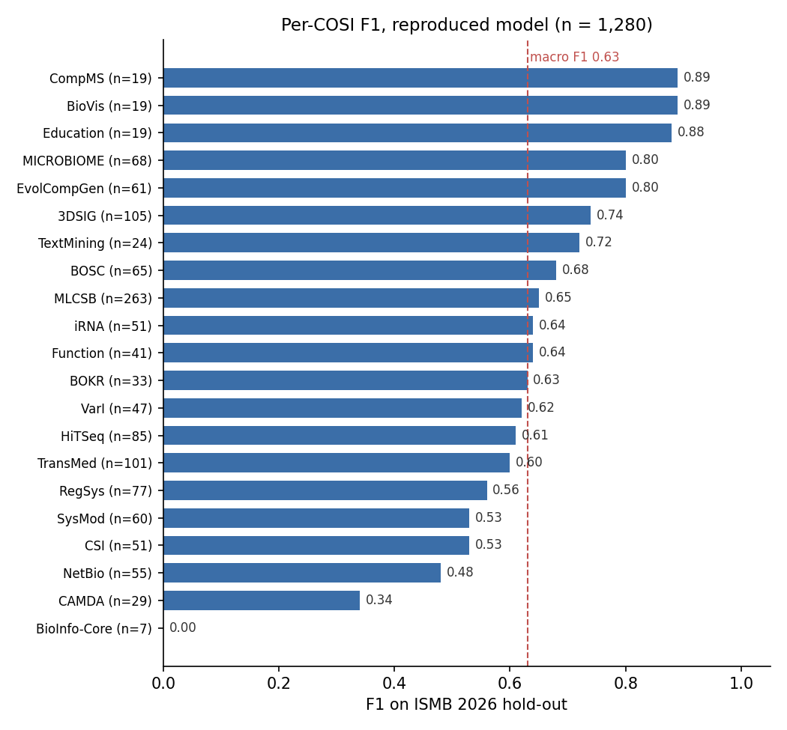

# Experiments: reproduction, independent evaluation set, single- vs multi-label

Part of the work tracked in [#1](https://github.com/danfdeblasio/cosipredictor/issues/1).
Data: the 21 CSVs of ISCB accepted submissions (not in the repo), placed in `../data/ISCB accepted submissions/`.
Environment: Python 3.11, scikit-learn 1.8.0 (METHODS.md used 1.6.1), pandas 2.2.1, NumPy 1.26.4.

| Step | Result |
|---|---|
| 1. Reproduce METHODS.md | **Reproduced.** All metrics within 0.001 of the reported values. |
| 2. Independent evaluation set | Year-based split; 4 near-duplicate test documents removed. Only 14 documents in the whole dataset have more than one COSI (0 in test). |
| 3. Single- vs multi-label | One-vs-rest is **not better** than the current model. Suggesting every COSI above a probability threshold gives most of the benefit with no new model. |

## 1. Reproduction of METHODS.md

```
python train.py "../data/ISCB accepted submissions" --holdout ISMB2026 --out ../results/model_repro.joblib
```

The repo's `model.joblib` was not modified. Log: [`results/repro_train_log.txt`](results/repro_train_log.txt).

Data filtering matches METHODS.md exactly:

| Records | Removed | Remaining |
|---|---|---|
| All CSV rows | | 14,678 |
| Rejected submissions | −273 | 14,405 |
| Tracks that are not COSIs | −5,069 | 9,336 |
| Duplicates (same title and COSI) | −233 | **9,103** |

| Metric (ISMB 2026 hold-out, n = 1,280) | METHODS.md | Reproduced |
|---|---|---|
| Top-1 accuracy | 0.651 | 0.650 |
| Top-3 accuracy | 0.912 | 0.913 |
| Top-5 accuracy | 0.957 | 0.957 |
| Macro F1 | 0.630 | 0.63 |

The log prints macro F1 with two decimals. Differences are within rounding and the scikit-learn version change.
Not re-run: bootstrap confidence intervals, calibration, SPECTER2 and stemming comparisons.



BioInfo-Core (7 test submissions) is never predicted correctly; CAMDA has precision 1.00 but recall 0.21.

## 2. Independent evaluation set

```
python experiments/eval_set.py "../data/ISCB accepted submissions"
```

- Split by conference year so evaluation always looks forward: train 2019–2024 (6,224 documents),
  validation 2025 (1,598; only used to tune thresholds), test 2026 (1,276).
- Rows from the same year with the same normalized title are merged into one document with a *set* of COSIs.
- Test documents with TF-IDF cosine ≥ 0.8 (title + abstract) to any earlier document are removed: 4 documents
  (2 of them ≥ 0.95, likely resubmissions).
- Report: [`results/eval_set_report.md`](results/eval_set_report.md). The manifest with document IDs and titles
  (`eval_set_manifest.csv`) is git-ignored because it contains submission data.

**Finding:** only 14 documents carry more than one COSI (11 train, 3 validation, 0 test), and several are
placeholders ("TBA", "TBD", "Q&A", "Closing remarks"). The accepted-track data has almost no multi-label ground truth.

## 3. Single-label vs multi-label

```
python experiments/compare_multilabel.py "../data/ISCB accepted submissions"
```

- **SL** = the current model (softmax logistic regression, same features as `train.build_pipeline`).
- **OvR** = one-vs-rest logistic regression trained on COSI sets.
- Thresholds are tuned on 2025, models are refit on 2019–2025 and tested once on 2026.

| System (test 2026, n = 1,276) | Correct COSI among suggestions | Avg. COSIs suggested | Sample F1 |
|---|---|---|---|
| SL top-1 (current model) | 0.654 | 1.00 | 0.654 |
| SL threshold p ≥ 0.17 | **0.761** | 1.42 | **0.656** |
| SL top-3 | 0.914 | 3.00 | 0.457 |
| OvR top-1 | 0.646 | 1.00 | 0.646 |
| OvR threshold s ≥ 0.48 | 0.706 | 1.22 | 0.645 |

- As a ranker, OvR is slightly worse: top-1 −0.008 (95% paired bootstrap CI −0.019 to +0.002), top-3 0.905 vs 0.914.
- At the same average number of suggestions the two are tied (1.5 COSIs: 0.778 vs 0.775; 2.0 COSIs: 0.853 vs 0.844).
- Full report: [`results/multilabel_report.md`](results/multilabel_report.md); all thresholds:
  [`results/threshold_curve.csv`](results/threshold_curve.csv).

## Caveats and next steps

- With no multi-COSI documents in the test set, the "multi-label" numbers measure how often the single accepted COSI
  is among the suggestions, not agreement with true multiple labels. A real multi-label evaluation needs a
  hand-labeled set (e.g. the Wikipedia gold standard).
- Placeholder titles (TBA, Q&A, Closing remarks…) are in the training data and should be cleaned.
- `compare_multilabel.py` writes Markdown tables with `pandas.DataFrame.to_markdown`, which needs the `tabulate` package.
